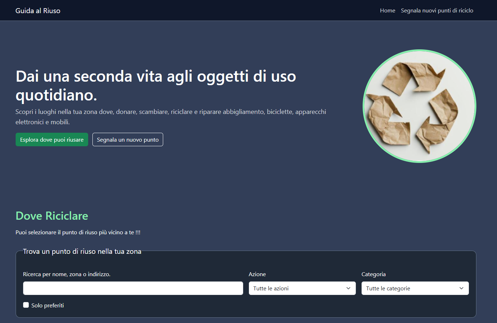

#♻️ Guida al Riuso

Guida al Riuso è un'applicazione web interattiva progettata per aiutare i cittadini a individuare facilmente i punti di riciclo, riparazione, donazione e scambio sul territorio. 

🔗 Demo Live su Netlify: https://direction-squad.netlify.app/ 

##📸 Anteprima del Progetto

##✨ Funzionalità Principali

Esplorazione Dinamica dei Punti: Visualizzazione immediata dei luoghi disponibili tramite card generate dinamicamente, complete di categoria, azione consigliata, descrizione, zona, indirizzo e orari di apertura.

Ricerca e Filtri:

Ricerca testuale in tempo reale per nome, zona o indirizzo.

Filtro per Azione (es. Riparare, Donare, Scambiare, Riciclare).

Filtro per Categoria (es. Biciclette, Abbigliamento, Elettronica, Mobili).

Gestione Preferiti (localStorage): Possibilità di salvare i propri punti di interesse con un clic e di filtrare la vista per visualizzare esclusivamente i luoghi preferiti, mantenendo i dati salvati nel browser dell'utente.

Segnalazione Nuovi Punti: Sezione dedicata per proporre e segnalare nuove realtà virtuose sul territorio.

##🛠️ Tecnologie Utilizzate

Il progetto adotta un'architettura Frontend-only, leggera e veloce, senza necessità di un backend esterno:

HTML, CSS & Bootstrap,JavaScript.

##🚀 Come Avviare il Progetto in Locale

Essendo un'applicazione puramente frontend, non richiede installazioni di dipendenze, database o server complessi:

Clona il repository sul tuo computer:

git clone https://github.com/GiuliaSenes/Direction-Squad.git

Entra nella cartella del progetto:

cd Direction-Squad

Avvia l'applicazione:

apri la cartella su Visual Studio Code, installa l'estensione Live Server, fai clic con il tasto destro su index.html e seleziona "Open with Live Server" .

👥 Divisione dei Compiti e Team

Il progetto è stato realizzato in collaborazione suddividendo le responsabilità tecniche tra i membri del team:

Giulia Senes (GiuliaSenes) – Sviluppo della logica applicativa in JavaScript (app.js), strutturazione del dataset (data.js), implementazione dei filtri di ricerca combinati, sistema di salvataggio preferiti tramite localStorage, integrazione del traduttore e gestione del repository Git/GitHub. (Nota sui contributori nella cronologia Git: All'interno dei commit e delle statistiche del repository figura un terzo account collaboratore (SimoneQ). Si precisa che tali commit sono stati comunque effettuati da Giulia Senes). 

Giovanni (giacorsa) – Progettazione della struttura HTML, impostazione del layout responsivo con Bootstrap, cura dello stile grafico e dell'accessibilità dell'interfaccia.
